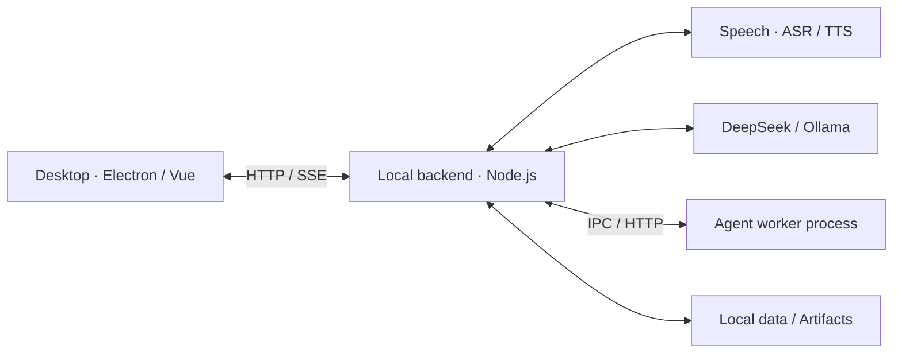

# Lingbo Desk · 聆泊

[简体中文](./README.md) | **English**

A Windows desktop voice agent for continuous conversation, an animated character, and file, Office, and browser tasks that run while you chat.

The installed release baseline is **0.3.0**. `main` includes subsequent Windows x64 development updates, with **0.3.4-test** as the portable test candidate.

## Original Live2D character preview


Character B has assembled artwork, independent eyelid controls, and a basic mouth rig. The image is a native export of the **t008** Cubism model. The character is currently at the editor validation stage.

## Features

- Chinese, Japanese, and English speech recognition and synthesis, continuous listening, natural interruptions, and cancellation of previous speech playback.
- A Live2D character with basic motions and speech-driven lip sync.
- Background task progress, pause, requirement changes, cancellation, and resumption after state checks.
- File and Office document processing, plus a separate browser session.
- Explicitly saved long-term memories, with Skills import and version management.
- Switching between the DeepSeek cloud API and local Ollama models.

## Recent development

- Agent tool allowlists, execution budgets, and checks for task outputs. [Execution notes](docs/work-execution-hardening.md)
- Windowed reads and precise edits for long Word documents, plus task recovery checks. [Verification notes](docs/long-documents-and-recovery.md)
- A Windows portable test build, a pink app icon, service connection checks, and encrypted credential storage. [Packaging notes](docs/windows-test-package.md) · [Configuration and evaluation](docs/service-onboarding-and-real-evaluation.md)
- Compatibility with older voice attachments was verified in a dedicated desktop candidate. Installed-app voice retesting is pending.

## Architecture



This is a responsibility overview. Speech adapters, model routing, task management, and tool execution are assembled within one local backend service; the branches do not represent independently deployed microservices.

| Module | Main responsibilities |
| --- | --- |
| Desktop | Character rendering, chat, audio capture and playback, continuous listening, and interruption handling |
| Local backend | HTTP APIs, task state and events, directory permissions, action confirmation, and actual tool execution |
| Speech adapters | Alibaba Cloud speech recognition, Doubao speech synthesis, audio decoding, and provider integration |
| Language models | The DeepSeek cloud API or local Ollama, providing streamed responses and tool calls |
| Agent worker | Runs the model and tool loop in a separate process; requests go through the local backend for execution and completion receipt checks |
| Local data | Explicit memories, Skills versions, task state, execution receipts, backups, and generated artifacts |

The desktop uses Electron, Vue 3, and TypeScript. A Node.js service exposes model, speech, task, permission, and personal configuration APIs.

The Agent worker runs the model and tool loop. Tool requests return to the main service for validation and execution. Task submission and actual completion are recorded separately. Directory grants, action confirmations, file hashes, backups, and execution receipts constrain file and browser operations.

Conversation and background work are scheduled separately so you can keep talking while a task runs. Python handles some document and audio processing.

Detailed documentation is currently in Chinese: [Backend architecture](docs/backend-architecture.md) · [Setup](docs/setup.md) · [Source layout](docs/source-layout.md) · [Verification record](docs/verification.md).

## Quick start

Requirements: Node.js 24, pnpm 11, and Python 3.12. See [Setup (Chinese)](docs/setup.md) for initial configuration, dependency installation, and character asset import.

```powershell
pnpm --dir desktop install --frozen-lockfile
pnpm --dir engine install --frozen-lockfile
pnpm --dir speech install --frozen-lockfile
python -m venv .venv
.venv/Scripts/python -m pip install -r requirements.txt
Copy-Item .env.example .env
# Edit .env and enter your own provider credentials
pnpm start
```

The backend defaults to `http://127.0.0.1:3850`. Building the desktop app also requires importing Cubism Core after accepting its applicable terms yourself. SDK binaries and character model packages are not included in this source repository.

```powershell
pnpm --dir desktop run build:modules
$env:LIVE2D_CORE_PATH="C:/your-sdk/Core/live2dcubismcore.min.js"
pnpm run prepare:desktop
pnpm run build:desktop
```

## Checks

```powershell
pnpm test
pnpm run verify:task
pnpm run check:source
pnpm --dir desktop run typecheck
```

See the [Verification record (Chinese)](docs/verification.md) for the scope and observed results. The source checker inspects Git-tracked and eligible untracked files for personal absolute paths and credential patterns. An additional deny pattern can be supplied on the command line.

## Current limitations

- Long-term memory requires explicit saving; automatic extraction and vector retrieval are not implemented.
- General work and staged report generation still use two task workflows.
- Using a local language model does not make cloud speech services work offline.
- The separate worker process is not an operating system sandbox. Skills scripts run with the current user's permissions.
- Complex Office documents, long-running sessions, sleep and wake, and deployment across machines need further validation.

## Third-party components and assets

Libraries, fonts, icons, models, and SDKs remain subject to their respective terms. See [Third-party notices](THIRD-PARTY-NOTICES.md).

This repository excludes personal configuration, credentials, chat history, installed dependencies, and previous Git history. A separate distribution license for the main project has not yet been specified.
