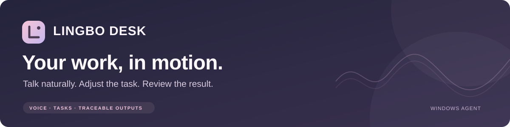
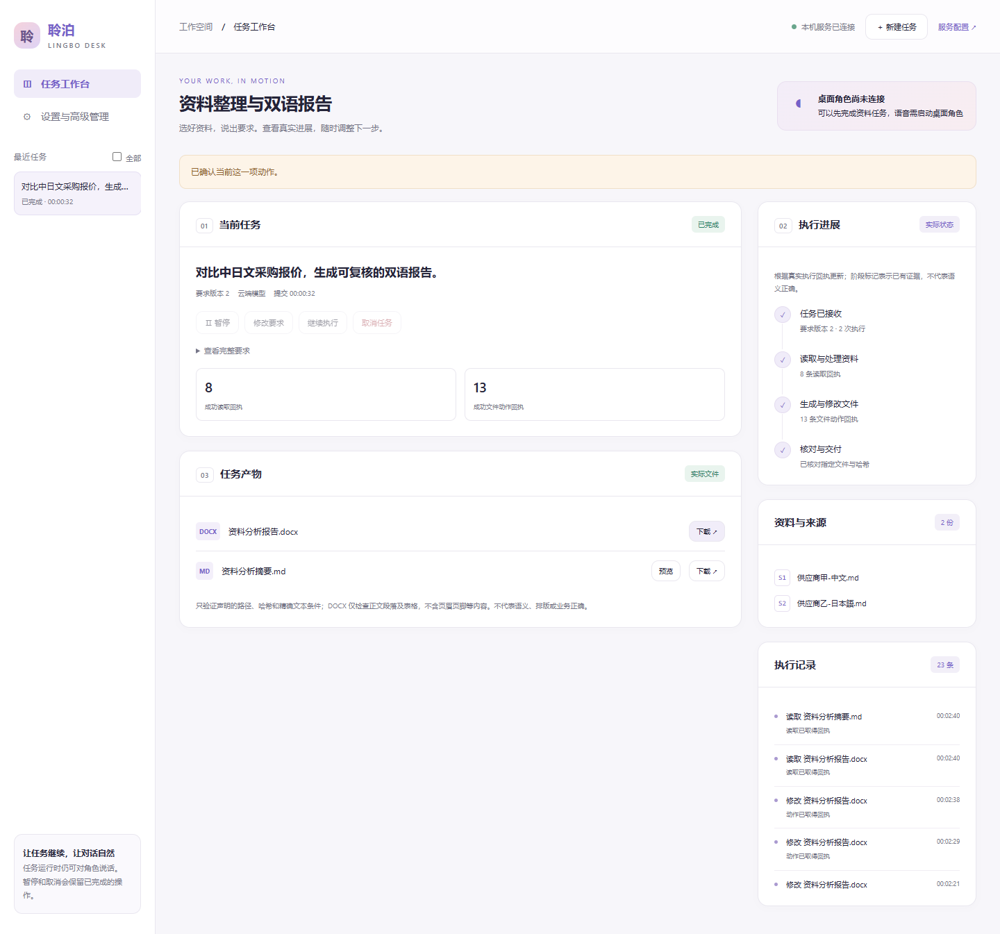
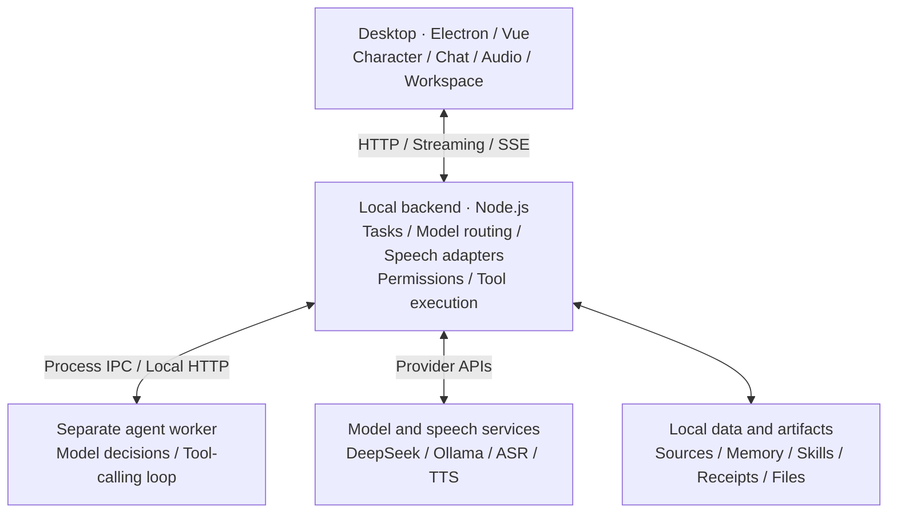

<p align="center">
  
</p>

<p align="center"><a href="README.md">简体中文</a> · <strong>English</strong></p>

<p align="center">
  <a href="#from-a-request-to-reviewable-deliverables">Real workflow</a> ·
  <a href="#designing-for-controllable-agent-work">Product decisions</a> ·
  <a href="#architecture">Architecture</a> ·
  <a href="#quick-start">Quick start</a> ·
  <a href="docs/verification.md">Validation</a>
</p>

<p align="center">
  
  
  
  <a href="LICENSE"></a>
</p>

# Lingbo Desk · 聆泊

**Start desktop work through conversation, adjust requirements as it runs, and review the files it actually produces.**

Lingbo Desk is a Windows voice agent prototype combining continuous conversation, an original Live2D character and background execution. It explores personal research and document workflows: keep chatting during a task, pause to change requirements, review proposed changes to existing files, then download and check the deliverables.

<table>
  <tr>
    <td width="74%" align="center" valign="middle">
      <a href="docs/images/task-workbench.png"></a>
      <sub>Actual workspace · Versions / Receipts / Sources / Deliverables</sub>
    </td>
    <td width="26%" align="center" valign="middle">
      
      <br /><strong>Original Character B</strong><br />
      <sub>Blinking · Basic lip sync<br />Continuous listening · Interruption</sub>
    </td>
  </tr>
</table>

*The workspace screenshot is from a real-model test using synthetic quotations. Its desktop character is disconnected; it is not evidence of a joint voice/task session. The character on the right is a separate model export.*

The local installation remains **0.3.7**. Newer source includes input diagnostics, disabled by default, and subsequent validation records; no updated installer has shipped. This repository distributes source code, not a public installer. [Changelog](CHANGELOG.md) · [Known issues](#validation-and-current-boundaries)

## Watch the workflow in about a minute

[](docs/media/lingbo-workflow-demo.webm)

[**▶ Open the actual task demo (about one minute, silent)**](docs/media/lingbo-workflow-demo.webm)

Upload sources, run a background task, pause and revise it, then inspect the generated summary and Word download. The edit uses a roughly 153-second recording, omitting the middle sequence of individual approvals and marking that omission with a title card. Approval screens containing local paths are not published. **This is text-operated, real-model execution, not a voice demo or a task-duration benchmark.** [Editing and validation scope](docs/homepage-showcase.md)

## From a request to reviewable deliverables

> “Compare these Chinese and Japanese supplier quotations. Explain quantity, tax, shipping and delivery differences. Produce a Chinese Word report with a Japanese summary and questions to confirm.”

| Step | User involvement | Actual system behavior |
| --- | --- | --- |
| Supply context | Upload two quotations and define deliverables | Save read-only, numbered source snapshots and create a session-owned task |
| Background execution | Inspect progress and continue talking | Run a separate worker; update progress from actual tool receipts |
| Revise requirements | Pause and clarify that shipping/tax assumptions must remain explicit | Save a new requirements version and resume after state checks; pausing does not undo prior changes |
| Review changes | Inspect and approve a concrete modification | Check permissions and the original SHA256, back up the file, execute and record a receipt |
| Review the result | Download Word and Markdown; inspect references and open questions | Check declared outputs and fixed acceptance conditions, retaining source, version and execution evidence |

This case uses **synthetic inputs and real DeepSeek calls**, operated through text in the workspace. It demonstrates task control and delivery; it is neither a procurement accuracy benchmark nor a complete human microphone-driven workflow.

[Full case and product tradeoffs](docs/HR-展示案例.md) · [Demo inputs](docs/demo-inputs) · [Real-model text validation](docs/headless-text-verification.md)

## Designing for controllable agent work

| Decision | User problem | Implementation |
| --- | --- | --- |
| **Schedule conversation and work separately** | A long task should leave room for conversation and progress queries | Foreground chat orchestration plus a separate worker |
| **Pause, revise, then resume** | Requirements change during execution | Task state machine, requirement versions and checked resumption |
| **Approve concrete actions** | A broad request should not authorize arbitrary changes | Directory grants, action previews, SHA256, backups and receipts |
| **Check delivery against evidence** | A model saying “done” does not establish a real deliverable | `work_finish`, current-version receipts, output hashes and declared checks |
| **Keep human review in the workflow** | Citations and valid files can still contain mistaken business reasoning | Read-only snapshots, paragraph identifiers, artifact previews and unresolved questions |

Project work covers requirements, interaction flows, architecture tradeoffs and acceptance design, with Codex assisting implementation and validation. Capabilities combine the local integration layer, an incorporated execution engine and third-party components. Original code, third-party code and character assets have separate licensing terms; see [License](#license).

## Capabilities

| Area | Current scope |
| --- | --- |
| Voice | Chinese / Japanese / English recognition and synthesis, continuous listening, interruption and cancellation of old playback; recognition follows audio segmentation, not an end-to-end audio model |
| Character | Original Live2D character, blinking, basic motion, audio-amplitude-driven mouth opening and window dragging |
| Background work | Files, Office, a separate browser session, progress, pause / revision / cancellation / checked resumption |
| Skills | Local import, enable/disable, content versions and task pinning; no automatic cross-agent synchronization or online marketplace |
| Memory and models | Explicitly saved long-term memories; DeepSeek cloud API / local Ollama selection, with speech configured separately |

## Architecture



Model routing and speech adapters run inside the local service and call their providers or local Ollama. These branches are not separate microservices. The desktop retains chat orchestration, audio capture, playback and interruption handling. Worker requests pass through the gateway; the backend validates and performs actual file operations.

| Source entry | What to inspect |
| --- | --- |
| [Desktop bootstrap](desktop/launcher/package-bootstrap.mjs) / [Workspace window](desktop/launcher/workspace-window.mjs) | Single instance, service lifecycle and unified entry point |
| [Gateway](backend/server.mjs) / [Model router](backend/model-router.mjs) | Session ownership, streamed responses, model selection and cancellation |
| [Task service](backend/work-service.mjs) / [Worker](backend/work-worker.mjs) | Task state, versions, child processes and the tool-calling loop |
| [Tools](backend/work-tools.mjs) / [Policy](backend/work-policy.mjs) | Files, Office, browser, approvals and evidence |
| [Completion checks](backend/work-finalize.mjs) / [Tool contracts](backend/work-schema.mjs) | Tool budgets, completion receipts and output checks |
| [Skills](backend/personal-skills.mjs) / [Personal store](backend/personal-store.mjs) | Skill imports, content versions and explicit memory |

Detailed documents are currently in Chinese: [Backend architecture](docs/backend-architecture.md) · [Source layout](docs/source-layout.md) · [Execution boundaries](docs/work-execution-hardening.md).

## Validation and current boundaries

| Evidence | What it supports | What it does not establish |
| --- | --- | --- |
| 142 backend checks; 3 monitor tests rerun for the diagnostic source upload | Behavior within those tests | Real task success rates or desktop responsiveness |
| 11 real-model text validation checkpoints | Fixed samples of chat, task controls, delivery, cancellation and restart state loading | 11 independent business tasks, long-term reliability or end-to-end voice acceptance |
| 69 chat-runtime + 7 interruption tests with mocks | Turn ownership and obsolete-output handling under mocked providers / receipts | Physical microphone behavior, echo control or actual sound stopping |
| Human feedback on 0.3.5 and historical integration records | Confirmed continuous conversation, basic lip sync and interruption on that version | Complete voice/task acceptance or performance benchmarks for the newest version |

**Open work:** Chat focus delays, blank windows and exit causes observed in isolated desktop tests remain unresolved. One real-model sample described completion inconsistently with backend state. Memory has no automatic extraction or vector retrieval. Complex Office documents, sleep/wake and cross-machine deployment need more validation. The worker is not an OS sandbox; Skills scripts run with the current user's permissions.

[Validation record](docs/verification.md) · [Text validation](docs/headless-text-verification.md) · [Desktop investigation](docs/chat-input-investigation.md) · [Changelog](CHANGELOG.md)

## Quick start

Requirements: Windows x64, Node.js 24, pnpm 11 and Python 3.12. See [Setup (Chinese)](docs/setup.md) for configuration, native dependencies and character assets.

```powershell
pnpm --dir desktop install --frozen-lockfile
pnpm --dir engine install --frozen-lockfile
pnpm --dir speech install --frozen-lockfile
python -m venv .venv
.venv/Scripts/python -m pip install -r requirements.txt
Copy-Item .env.example .env
# Set your own credentials, or save them encrypted through local setup after launch
pnpm start
```

The backend and task workspace default to `http://127.0.0.1:3850`. These commands start the backend. The desktop character needs a separate build and Cubism Core obtained after personally accepting its terms. Core, third-party characters and language model weights are not included.

<details>
<summary>Desktop build and checks</summary>

```powershell
pnpm --dir desktop run build:modules
$env:LIVE2D_CORE_PATH="C:/your-sdk/Core/live2dcubismcore.min.js"
pnpm run prepare:desktop
pnpm run build:desktop

pnpm test
pnpm run verify:task
pnpm run check:source
pnpm --dir desktop run typecheck
```

Interpret results within their documented scope. Automated checks do not establish real desktop task acceptance.

</details>

## Keywords

`AI Agent` · `Voice Agent` · `Desktop Automation` · `Tool Calling` · `Human-in-the-loop` · `Task Orchestration` · `Agent Skills` · `Electron` · `Vue 3` · `TypeScript` · `Node.js` · `Live2D` · `DeepSeek` · `Ollama`

## License

Original code that the project copyright holder is entitled to license is available under [MIT](LICENSE). Third-party code and components retain their respective licenses and notices; not all code is original to this project. Fonts, icons, models and SDKs follow their own terms. Original Live2D assets and previews are for project display and need separate permission for reuse. See [Third-party notices and assets](THIRD-PARTY-NOTICES.md).

Personal configuration, credentials, chat history and installed dependencies are excluded.
