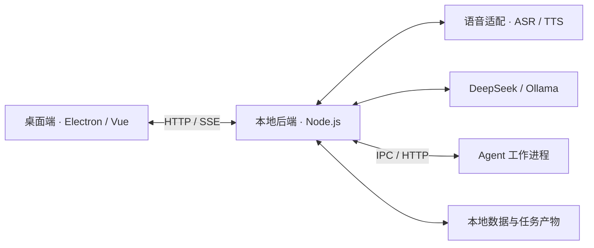

# 聆泊 · Lingbo Desk

**简体中文** | [English](./README.en.md)

Windows 桌面语音 Agent。支持持续交流、数字人展示，以及聊天期间执行文件、Office 和浏览器任务。

当前版本：0.3.0。个人项目，面向 Windows x64 验证。

## 功能

- 中、日、英语音识别与语音合成，持续监听、自然插话和停止旧播报。
- Live2D 角色、基础动作与语音口型联动。
- 后台工作任务的进度查询、暂停、修改、取消和检查后恢复。
- 文件与 Office 文档处理、独立浏览器会话。
- 明确保存的长期记忆、Skills 导入与版本管理。
- DeepSeek 云端模型和本机 Ollama 切换。

## 工程设计



这是职责概览图。语音适配、模型路由、任务管理和工具执行由同一个本地后端服务装配，图中的分支不代表独立微服务。

| 模块 | 主要职责 |
| --- | --- |
| 桌面端 | 角色展示、聊天、音频采集与播放、持续监听和打断 |
| 本地后端 | HTTP API、任务状态与事件、目录权限、动作确认和实际工具执行 |
| 语音适配 | 阿里云语音识别、豆包语音合成、音频解码与服务转接 |
| 语言模型 | DeepSeek 云端 API 或本机 Ollama，提供流式回答和工具调用 |
| Agent 工作进程 | 独立运行模型与工具调用循环，请求经本地后端执行并检查完成回执 |
| 本地数据 | 保存明确记忆、Skills 版本、任务状态、执行回执、备份与产物 |

桌面端采用 Electron、Vue 3 和 TypeScript。Node.js 服务提供模型、语音、任务、权限及个人配置接口。

Agent 工作进程运行模型工具调用循环。工具请求返回主服务校验和执行，任务提交与实际完成分开记录。
目录授权、具体动作确认、文件哈希、备份和执行回执共同约束文件及浏览器操作。

对话与后台工作分开调度，让任务运行期间仍能交流。Python 承担部分文档和音频处理。

[后端架构](docs/backend-architecture.md) · [环境与启动](docs/setup.md) · [目录说明](docs/source-layout.md) · [验收记录](docs/verification.md)

## 快速开始

环境：Node.js 24、pnpm 11、Python 3.12。首次配置、依赖安装和角色素材导入步骤见 [环境与启动](docs/setup.md)。

```powershell
pnpm --dir desktop install --frozen-lockfile
pnpm --dir engine install --frozen-lockfile
pnpm --dir speech install --frozen-lockfile
python -m venv .venv
.venv/Scripts/python -m pip install -r requirements.txt
Copy-Item .env.example .env
# 编辑 .env，填写自己的服务凭据
pnpm start
```

后端默认地址为 `http://127.0.0.1:3850`。桌面构建需要另外导入本人已接受条款的 Cubism Core；源代码仓库不包含 SDK 二进制或角色模型包。

```powershell
pnpm --dir desktop run build:modules
$env:LIVE2D_CORE_PATH="C:/your-sdk/Core/live2dcubismcore.min.js"
pnpm run prepare:desktop
pnpm run build:desktop
```

## 检查

```powershell
pnpm test
pnpm run verify:task
pnpm run check:source
pnpm --dir desktop run typecheck
```

检查范围和实测结果以 [验收记录](docs/verification.md) 为准。源码检查默认检查待提交文件、个人绝对路径及凭据形状，也支持通过命令行额外传入禁用词规则。

## 当前限制

- 长期记忆需要明确保存，未实现自动提炼与向量检索。
- 通用工作与分阶段报告仍保留两套任务流程。
- 本地模型不会使云端语音自动离线。
- 独立工作进程不是操作系统沙箱。Skills 脚本具有当前用户权限。
- 复杂 Office 文档、长时间运行、睡眠唤醒和跨设备部署仍需继续验证。

## 第三方组件与素材

运行库、字体、图标、模型与 SDK 遵循各自使用条款。详见 [第三方说明](THIRD-PARTY-NOTICES.md)。
仓库未包含个人配置、密钥、聊天记录、已安装依赖或旧的 Git 历史。项目主体的对外发布许可尚未另行指定。
