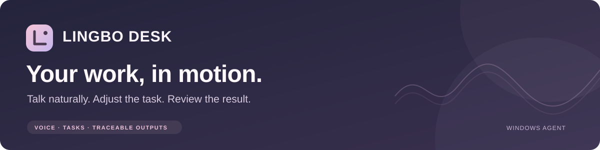
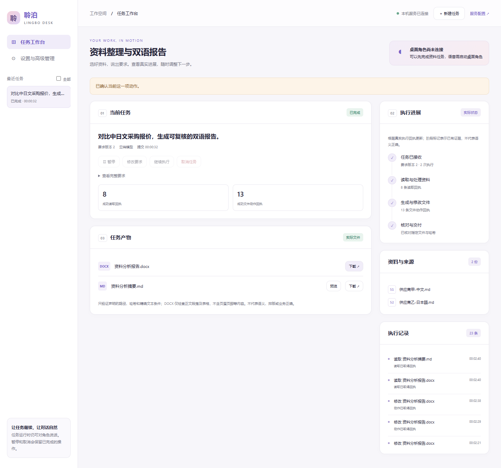
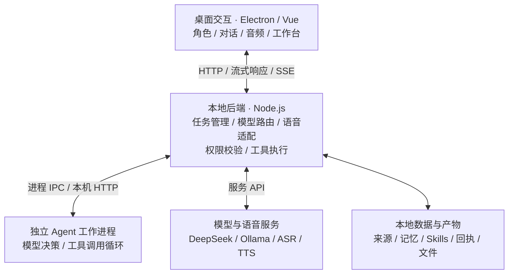

<p align="center">
  
</p>

<p align="center"><strong>简体中文</strong> · <a href="README.en.md">English</a></p>

<p align="center">
  <a href="#从一份要求到可复核的交付">真实案例</a> ·
  <a href="#让-agent-工作可控的设计">产品设计</a> ·
  <a href="#技术架构">技术架构</a> ·
  <a href="#快速开始">快速开始</a> ·
  <a href="docs/verification.md">验证记录</a>
</p>

<p align="center">
  
  
  
  <a href="LICENSE"></a>
</p>

# 聆泊 · Lingbo Desk

**用自然对话发起桌面工作，在执行过程中调整要求，获得可追溯的文件交付。**

聆泊是 Windows 桌面语音 Agent 原型，将持续对话、原创 Live2D 角色和后台执行结合起来。面向个人资料整理与文档工作：任务运行时继续交流，需要调整时暂停改要求，涉及已有文件的修改先查看具体动作，最后下载并复核实际产物。

<table>
  <tr>
    <td width="74%" align="center" valign="middle">
      <a href="docs/images/task-workbench.png"></a>
      <sub>真实工作台 · 要求版本 / 执行回执 / 来源 / 文件交付</sub>
    </td>
    <td width="26%" align="center" valign="middle">
      
      <br /><strong>原创角色 B</strong><br />
      <sub>自动眨眼 · 基础语音嘴型<br />持续监听 · 自然插话</sub>
    </td>
  </tr>
</table>

*工作台截图来自合成报价资料的真实模型测试；截图中的桌面角色未连接，不代表角色与工作台同场语音验收。右侧为独立角色导出预览。*

当前本机安装版为 **0.3.7**；最新源码另含默认关闭的输入诊断与后续联测记录，尚未发布新版安装包。本仓库提供源码，安装包暂不公开。[版本更新](CHANGELOG.md) · [已知问题](#验证与当前边界)

## 一分钟看实际流程

[](docs/media/lingbo-workflow-demo.webm)

[**▶ 打开真实任务演示（约一分钟，无音频）**](docs/media/lingbo-workflow-demo.webm)

上传资料、后台执行、暂停改版，再查看实际摘要与 Word 下载。剪辑取自约 153 秒的原始录屏，省略中段逐项确认，并用说明卡标注；含本机路径的确认画面未公开。**这是文字操作与真实模型执行，不是语音演示，也不是任务耗时基准。** [剪辑与验证范围](docs/homepage-showcase.md)

## 从一份要求到可复核的交付

> “比较这两份中日文供应商报价，说明数量、税费、运费和交期差异，生成中文 Word 报告，附日文摘要与待确认事项。”

| 环节 | 用户怎么参与 | 系统实际做什么 |
| --- | --- | --- |
| 提供资料 | 上传一份中文、一份日文报价，说明交付要求 | 保存只读编号快照，创建归属于当前会话的任务 |
| 后台执行 | 查看进展，继续与角色交流 | 独立工作进程运行工具调用循环，以实际回执更新任务 |
| 调整要求 | 暂停，补充“运费税费口径未明确，不要直接判断谁更便宜” | 保存新版本要求，检查状态后恢复；暂停不会回滚已发生的操作 |
| 审阅修改 | 查看拟修改的文件与内容，确认具体动作 | 检查权限和原文件 SHA256，备份后执行，记录回执 |
| 取得结果 | 下载 Word 与 Markdown，核对引用和待确认项 | 检查声明产物及固定验收条件，保留来源、版本与执行证据 |

该案例使用**虚构资料与真实 DeepSeek**，通过文字操作工作台完成。它展示任务控制与交付流程，不是采购决策准确率评测，也不代表真人语音完成整条任务链。

[完整案例与产品取舍](docs/HR-展示案例.md) · [输入资料](docs/demo-inputs) · [真实后台文字联测](docs/headless-text-verification.md)

## 让 Agent 工作可控的设计

| 设计 | 要解决的使用问题 | 实现依据 |
| --- | --- | --- |
| **对话与工作分开调度** | 长任务运行时，用户仍能交流与查询进度 | 前台对话编排 + 独立 Agent 工作进程 |
| **暂停后修改要求** | 执行过程中发现遗漏，不必只依靠重新提问 | 任务状态机、要求版本、检查后恢复 |
| **具体动作确认** | “帮我改文档”不能等同于任意修改授权 | 目录权限、动作预览、SHA256、备份和执行回执 |
| **用证据确认交付** | 模型说“完成”不代表文件真的存在或符合要求 | `work_finish`、当前版本回执、产物哈希与声明条件检查 |
| **保留人的复核位置** | 有引用和文件仍可能存在业务理解错误 | 只读资料快照、段落编号、产物预览和待确认事项 |

产品工作包括需求定义、交互流程、架构取舍和验收设计，工程实现与验证使用 Codex 辅助。具体能力由本地集成层、引入的执行引擎及第三方组件共同提供；原创代码、第三方代码与角色素材的授权分别见[许可说明](#许可证)。

## 能力概览

| 方向 | 当前范围 |
| --- | --- |
| 语音交流 | 中 / 日 / 英识别与合成、持续监听、自然插话、停止旧播报；音频切分后识别，不是端到端音频模型 |
| 桌面角色 | 原创 Live2D 角色、眨眼、基础动作、音频强度驱动的嘴部开合与窗口拖动 |
| 后台工作 | 文件与 Office 处理、独立浏览器会话、进度查询、暂停 / 修改 / 取消 / 检查后恢复 |
| Skills | 本地导入、启停、内容版本及任务版本绑定；尚无跨 Agent 自动同步或在线技能市场 |
| 记忆与模型 | 明确保存的长期记忆；DeepSeek 云端 API / 本机 Ollama 切换，语音服务单独配置 |

## 技术架构



模型与语音适配模块位于本地服务内，实际请求对应的服务商或本机 Ollama；图中分支不代表独立微服务。桌面端仍负责对话编排、音频采集、播放与打断。工作进程通过网关调用模型与工具，真实文件操作由后端校验后执行。

| 源码入口 | 关注点 |
| --- | --- |
| [桌面启动器](desktop/launcher/package-bootstrap.mjs) / [工作台窗口](desktop/launcher/workspace-window.mjs) | 单实例、服务生命周期与统一入口 |
| [网关](backend/server.mjs) / [模型路由](backend/model-router.mjs) | 会话归属、流式响应、模型选择与请求取消 |
| [任务服务](backend/work-service.mjs) / [工作进程](backend/work-worker.mjs) | 任务状态、版本、子进程与工具调用循环 |
| [工具执行](backend/work-tools.mjs) / [权限策略](backend/work-policy.mjs) | 文件、Office、浏览器、动作确认与执行证据 |
| [完成检查](backend/work-finalize.mjs) / [工具契约](backend/work-schema.mjs) | 工具预算、完成回执与产物验收 |
| [Skills](backend/personal-skills.mjs) / [个人存储](backend/personal-store.mjs) | 技能导入、版本与明确记忆 |

[后端架构详解](docs/backend-architecture.md) · [源码目录](docs/source-layout.md) · [工具执行边界](docs/work-execution-hardening.md)

## 验证与当前边界

| 证据 | 能说明什么 | 不能据此推导什么 |
| --- | --- | --- |
| 142 项后端自动化检查；诊断源码上传时另复核 3 项监测测试 | 各自测试范围内的逻辑行为 | 真实任务成功率或桌面流畅度 |
| 11 个真实模型文字联测检查点 | 多轮对话、任务控制、文件交付、取消和重启读状态的固定样本 | 11 个独立业务任务、长期稳定性或语音端到端通过 |
| 69 项对话运行时 + 7 项打断逻辑模拟测试 | 模拟 provider / 回执条件下的轮次归属与旧输出隔离 | 物理麦克风、回声抑制或实际声音停止 |
| 0.3.5 真人反馈与历史集成记录 | 该版本连续交流、嘴型、自然打断等已确认体验 | 最新版本完整语音任务链的验收或性能基准 |

**仍需完善**：隔离桌面测试中出现的聊天聚焦卡顿、空白窗口与退出原因尚未确定；真实模型样本曾出现完成说明与后台状态不一致。长期记忆尚无自动提炼与向量检索；复杂 Office、睡眠唤醒和跨设备部署需继续验证。独立工作进程不是操作系统沙箱，Skills 脚本具有当前用户权限。

[完整验证记录](docs/verification.md) · [后台文字联测](docs/headless-text-verification.md) · [桌面问题排查](docs/chat-input-investigation.md) · [版本更新](CHANGELOG.md)

## 快速开始

环境：Windows x64、Node.js 24、pnpm 11、Python 3.12。首次配置、原生依赖与角色素材说明见[环境与启动](docs/setup.md)。

```powershell
pnpm --dir desktop install --frozen-lockfile
pnpm --dir engine install --frozen-lockfile
pnpm --dir speech install --frozen-lockfile
python -m venv .venv
.venv/Scripts/python -m pip install -r requirements.txt
Copy-Item .env.example .env
# 编辑 .env，填写自己的服务凭据；也可启动后在本机配置页面加密保存
pnpm start
```

后端与任务工作台默认地址为 `http://127.0.0.1:3850`。以上命令启动后端；桌面角色需要另行构建，并导入本人已接受适用条款的 Cubism Core。仓库不包含 Core、第三方角色或语言模型权重。

<details>
<summary>桌面构建与检查命令</summary>

```powershell
pnpm --dir desktop run build:modules
$env:LIVE2D_CORE_PATH="C:/your-sdk/Core/live2dcubismcore.min.js"
pnpm run prepare:desktop
pnpm run build:desktop

pnpm test
pnpm run verify:task
pnpm run check:source
pnpm --dir desktop run typecheck
```

检查结果需结合相应验证记录理解；运行自动化测试不等同于真实桌面任务验收。

</details>

## 关键词

`AI Agent` · `Voice Agent` · `Desktop Automation` · `Tool Calling` · `Human-in-the-loop` · `Task Orchestration` · `Agent Skills` · `Electron` · `Vue 3` · `TypeScript` · `Node.js` · `Live2D` · `DeepSeek` · `Ollama`

## 许可证

聆泊原创且由项目权利人有权授权的代码采用 [MIT 许可证](LICENSE)。引入的第三方代码及组件适用各自的许可证及版权声明；这不表示全部代码均由本项目原创。字体、图标、模型与 SDK 遵循各自条款。原创 Live2D 素材及预览用于项目展示，复用需另行取得授权，详见[第三方组件与素材说明](THIRD-PARTY-NOTICES.md)。

仓库不包含个人配置、密钥、聊天记录或已安装依赖。
