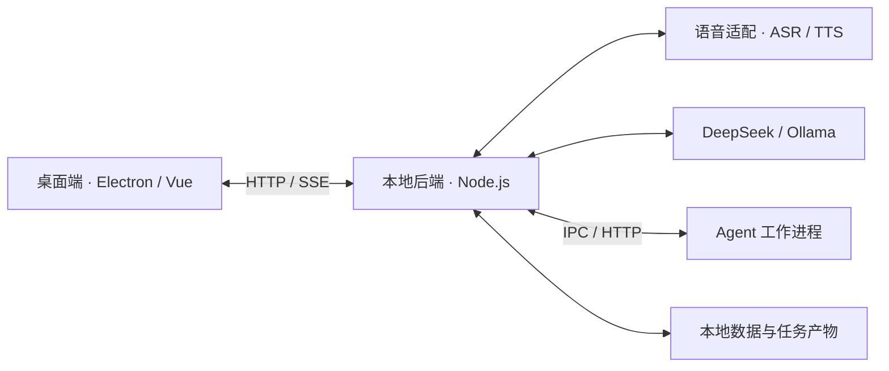

# 聆泊 · Lingbo Desk

**简体中文** | [English](./README.en.md)

Windows 桌面语音 Agent。支持持续交流、数字人展示，以及聊天期间执行文件、Office 和浏览器任务。

当前源码及本机已验收的 Windows 安装版为 **0.3.5**。本仓库提供源码，安装包暂不公开发布。[版本说明](CHANGELOG.md) · [真实模型与语音验收](docs/acceptance-0.3.5.md)

## 原创 Live2D 角色预览


角色 B 已接入桌面安装版，支持自动眨眼及音频强度驱动的基础嘴部开合，真人语音验收已通过。图片来自 **t008** 模型的原生导出。[接入记录](docs/original-character-integration.md)

## 功能

- 中、日、英语音识别与语音合成，持续监听、自然插话和停止旧播报。
- Live2D 角色、基础动作与语音口型联动。
- 后台工作任务的进度查询、暂停、修改、取消和检查后恢复。
- 文件与 Office 文档处理、独立浏览器会话。
- 明确保存的长期记忆、Skills 导入与版本管理。
- DeepSeek 云端模型和本机 Ollama 切换。

## 近期开发更新

- Agent 工具白名单、调用预算与文件产物验收。[执行记录](docs/work-execution-hardening.md)
- 长 Word 分段读取、精确修改和任务故障恢复。[验证记录](docs/long-documents-and-recovery.md)
- Windows 便携测试包、粉色应用图标、服务连接检查及密钥加密保存。[测试包说明](docs/windows-test-package.md) · [配置与评测](docs/service-onboarding-and-real-evaluation.md)
- 0.3.5 整合历史语音附件兼容、本地账号登录防循环、拖动修复及原创角色；已完成本机安装升级和正常重启。[收口记录](docs/release-0.3.5.md)
- 当前安装版已获连续语音、嘴型及自然打断正常反馈；真实 DeepSeek 文件、DOCX 与独立浏览器小样本验收通过。这些结果不代表通用成功率或长期稳定性。[验收范围](docs/acceptance-0.3.5.md)

## 工程设计



这是职责概览图。语音适配、模型路由、任务管理和工具执行由同一个本地后端服务装配，图中的分支不代表独立微服务。

| 模块 | 主要职责 |
| --- | --- |
| 桌面端 | 角色展示、聊天、音频采集与播放、持续监听和打断 |
| 本地后端 | HTTP API、任务状态与事件、目录权限、动作确认和实际工具执行 |
| 语音适配 | 阿里云语音识别、豆包语音合成、音频解码与服务转接 |
| 语言模型 | DeepSeek 云端 API 或本机 Ollama，提供流式回答和工具调用 |
| Agent 工作进程 | 独立运行模型与工具调用循环，请求经本地后端执行并检查完成回执 |
| 本地数据 | 保存明确记忆、Skills 版本、任务状态、执行回执、备份与产物 |

桌面端采用 Electron、Vue 3 和 TypeScript。Node.js 服务提供模型、语音、任务、权限及个人配置接口。

Agent 工作进程运行模型工具调用循环。工具请求返回主服务校验和执行，任务提交与实际完成分开记录。
目录授权、具体动作确认、文件哈希、备份和执行回执共同约束文件及浏览器操作。

对话与后台工作分开调度，让任务运行期间仍能交流。Python 承担部分文档和音频处理。

[后端架构](docs/backend-architecture.md) · [环境与启动](docs/setup.md) · [目录说明](docs/source-layout.md) · [验收记录](docs/verification.md)

## 快速开始

环境：Node.js 24、pnpm 11、Python 3.12。首次配置、依赖安装和角色素材导入步骤见 [环境与启动](docs/setup.md)。

```powershell
pnpm --dir desktop install --frozen-lockfile
pnpm --dir engine install --frozen-lockfile
pnpm --dir speech install --frozen-lockfile
python -m venv .venv
.venv/Scripts/python -m pip install -r requirements.txt
Copy-Item .env.example .env
# 编辑 .env，填写自己的服务凭据
pnpm start
```

后端默认地址为 `http://127.0.0.1:3850`。桌面构建需要另外导入本人已接受条款的 Cubism Core。仓库仅附原创角色 B 的运行素材和预览，不包含 Cubism Core、第三方角色模型或语言模型权重；素材授权与代码 MIT 许可证分开处理。

```powershell
pnpm --dir desktop run build:modules
$env:LIVE2D_CORE_PATH="C:/your-sdk/Core/live2dcubismcore.min.js"
pnpm run prepare:desktop
pnpm run build:desktop
```

## 检查

```powershell
pnpm test
pnpm run verify:task
pnpm run check:source
pnpm --dir desktop run typecheck
```

检查范围和实测结果以 [验收记录](docs/verification.md) 为准。源码检查默认检查待提交文件、个人绝对路径及凭据形状，也支持通过命令行额外传入禁用词规则。

## 当前限制

- 长期记忆需要明确保存，未实现自动提炼与向量检索。
- 通用工作与分阶段报告仍保留两套任务流程。
- 本地模型不会使云端语音自动离线。
- 独立工作进程不是操作系统沙箱。Skills 脚本具有当前用户权限。
- 复杂 Office 文档、长时间运行、睡眠唤醒和跨设备部署仍需继续验证。

## 许可证

聆泊原创且由项目权利人有权授权的代码采用 [MIT 许可证](LICENSE)。引入的第三方代码和组件适用各自的许可证及版权声明。字体、图标、模型与 SDK 遵循各自使用条款。原创 Live2D 预览图用于项目展示，复用需另行取得授权。详见 [第三方组件与素材说明](THIRD-PARTY-NOTICES.md)。

仓库未包含个人配置、密钥、聊天记录、已安装依赖或旧的 Git 历史。
