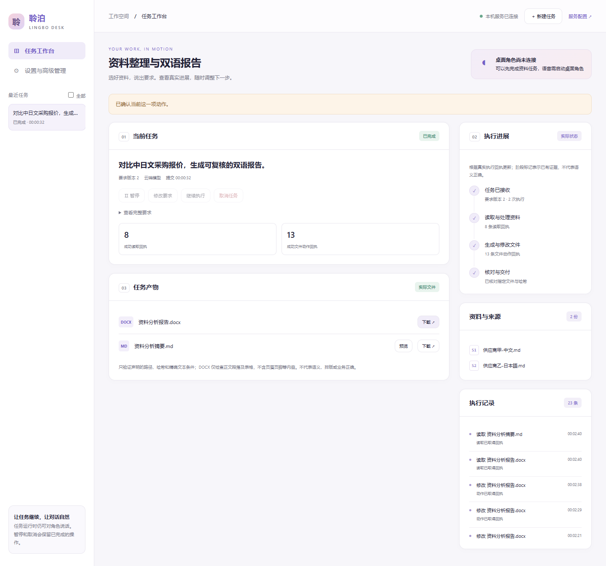

# Lingbo Desk 聆泊

**用自然对话发起工作，让执行过程可见，让结果能够复核。**

聆泊是 Windows 桌面语音 Agent 原型，将持续语音对话、Live2D 角色与后台文件、Office 和浏览器任务结合起来。目标场景是个人资料整理：用户继续交流，后台任务独立运行；涉及已有文件的修改，由用户查看具体动作后确认。

## 我负责的部分

需求定义、产品流程、整体架构取舍与验收设计，使用 Codex 辅助工程实现和验证。重点是把模型调用变成可控制的任务：区分聊天与执行，明确修改权限，提供暂停与恢复，保存实际操作证据。

## 一个完整场景

上传中文和日文两份供应商报价，要求比较数量、税费与运费口径，生成中文 Word 报告和日文摘要。运行期间暂停，核对原文后追加“运费是否含税未明确”的限制，再恢复执行。已有文件的修改逐项展示并确认；最后下载实际文件，对照段落编号复核依据。

## 展示中能看到的产品设计

| 设计 | 用户得到什么 | 实现依据 |
| --- | --- | --- |
| 对话与任务分开运行 | 任务不占用前台对话的执行循环 | 独立工作进程、任务状态和会话归属 |
| 真实进展 | 能看到已发生的读取与文件动作 | 工具回执驱动界面，不生成虚拟百分比 |
| 可调整的任务 | 暂停后修改要求，按新版本恢复 | 任务版本、状态检查、已有执行证据 |
| 修改前确认 | 知道将修改哪个文件、哪些内容 | 具体动作确认、SHA256、备份及执行回执 |
| 可复核的交付 | 能追溯原文并下载实际产物 | 只读编号快照、来源查看、产物验收与下载 |

## 已有证据与边界

本轮真实 DeepSeek 案例完成了资料读取、任务版本修改、文件修改确认、Word 和摘要生成；另有 131 项后端自动化测试和 6 组浏览器交互检查。它们证明各自测试范围内的行为，不能作为通用任务成功率。

报告首轮曾过度推定运费含税，复核后追加要求并纠正。来源编号、文件哈希和完成状态都不能代替语义检查。本案例也出现了多次逐项确认，后续应改善可审阅的批量修改体验，减少确认负担。

当前视频是独立环境中的**文字操作与真实模型执行**，没有真人语音或伪造配音。0.3.5 的真人语音、口型和打断已有用户验收；当前本机安装版 0.3.7 保留了 0.3.6 的统一入口，并补齐会话内已有任务的上下文衔接。新版本真人语音任务联动和新版演示视频仍待完成；本轮尚未发布到 GitHub。

技术说明与复现方法见 [工作台实施和验证记录](task-workbench-verification.md)。
