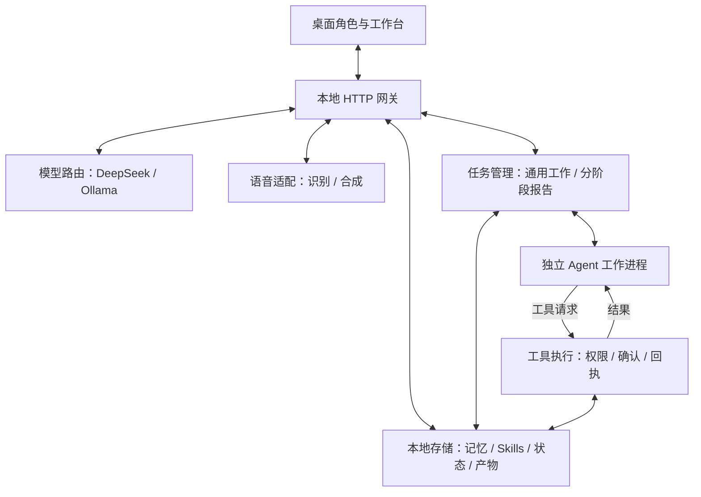

# 聆泊后端架构

版本：0.3.0  
核对日期：2026-11-04  
范围：当前本机代码已实现的后端，不包含后续规划。

## 1. 架构定位

当前是 **本地模块化服务 + 独立 Agent 工作进程**。

- 一个 Node.js HTTP 服务提供模型、语音、任务和个人配置接口。
- 通用工作任务在独立 Node.js 子进程中运行模型与工具调用循环。
- 实际文件、Office、浏览器和脚本操作，由本地服务中的工具执行模块接管。
- Electron 主进程启动、监控和关闭后端；聊天编排、持续监听、打断与播放仍有前端职责。

当前没有部署独立微服务集群，也没有引入 Redis、消息中间件或统一关系数据库。

## 2. 后端总览

以下是职责图。图中的模块不代表各自都是独立进程。



工作进程的模型请求和工具请求，都经过本地网关。工具执行模块与任务管理模块位于同一个后端服务进程。

## 3. 进程与通信

| 运行单元 | 职责 | 通信方式 |
| --- | --- | --- |
| Electron 主进程 | 启动后端、托管角色页面、关闭时清理服务 | 子进程启动、Electron IPC |
| 桌面渲染进程 | 角色、聊天编排、音频采集与播放、打断 | 本机 HTTP、流式响应、SSE、Electron IPC |
| Node.js 后端 | API、模型路由、任务管理、工具执行、个人数据 | `127.0.0.1:3850` |
| Agent 工作进程 | 接收任务要求，运行模型与工具调用循环 | 进程 IPC、本机 HTTP |
| Python / 浏览器 / 脚本子进程 | 文档处理、独立浏览器操作、经确认的脚本 | 子进程调用；浏览器使用 CDP |

角色页面由本机静态服务通过 `localhost:5173` 提供。工作台由后端的 `127.0.0.1:3850` 提供。

## 4. 模块职责与源码

源码路径相对于 `仓库根目录`。

| 模块 | 文件 | 职责 |
| --- | --- | --- |
| 桌面启动器 | `package-bootstrap.mjs` | 单实例、数据目录、后端启动与有限重启、退出清理 |
| HTTP 网关 | `server.mjs` | 路由、连接校验、请求取消、模型与语音转接、事件推送 |
| 模型路由 | `model-router.mjs` | 选择模型、超时、探测、固定当前回合使用的模型 |
| 通用任务管理 | `work-service.mjs` | 创建、去重、归属、状态、版本、子进程、确认与恢复 |
| Agent 工作入口 | `work-worker.mjs` | 调用执行引擎，注册工具，通过网关请求模型和实际操作 |
| 执行引擎 | `../engine/src` | Agent 运行循环、模型工具调用与工具扩展接口 |
| 工具契约与完成检查 | `work-schema.mjs`、`work-finalize.mjs` | 工具参数定义、提交入口、完成回执与补充验收 |
| 工具与权限 | `work-tools.mjs`、`work-policy.mjs` | 文件操作、授权校验、备份、哈希、具体动作确认 |
| Office 与浏览器 | `work-office.py`、`work-browser.mjs` | 文档处理、独立 Edge 会话、页面读取与交互 |
| 分阶段报告 | `task-service.mjs`、`task-store.mjs` | 固定阶段、检查点、报告证据、持久化与恢复 |
| 资料处理 | `source-bundles.mjs`、`web-reader.mjs`、`documents.py` | 文件和网页资料快照、提取、报告导出 |
| 记忆与 Skills | `personal-store.mjs`、`personal-skills.mjs` | 明确记忆、模型偏好、技能导入与启停、内容版本 |
| 语音与观测 | `asr-file.mjs`、`voice-metrics.mjs`、`../speech/adapters` | 音频识别转接、语音合成适配、时延与错误记录 |

## 5. 三条主要请求链路

### 5.1 普通聊天

1. 桌面端整理当前对话，发起聊天请求。
2. 网关识别明确记忆指令和任务控制指令。
3. 普通聊天请求加入本机记忆、选定 Skills 和工具使用规则。
4. 模型路由调用 DeepSeek 或 Ollama，返回流式文本。
5. 桌面端负责显示回答，以及后续播报编排。

因此，后端网关并不独占完整的聊天状态机。角色端仍承担对话组织和交互调度。

### 5.2 语音

输入链路：`桌面采集与切分 → 音频上传 → 后端解码与识别适配 → 识别文字 → 聊天链路`。

输出链路：`回答文本 → 合成接口 → 语音服务 → 音频返回 → 桌面播放与口型`。

识别接入阿里云，合成使用现有豆包配置。持续监听、何时结束录音、播放队列和自然打断，不能全部归因于后端。

当前存在“录制片段上传，再转接识别”的处理环节。不能将它描述为麦克风到模型全程持续流式传输的端到端语音模型。

### 5.3 后台工作

1. 对话通过 `lingbo_submit_work` 提交任务；工作台也可以直接提交。
2. `WorkService` 保存任务要求、会话归属、模型、技能版本和可用目录。
3. 启动独立工作进程，传入任务及已有回执摘要。
4. 工作进程调用模型，模型提出 `work_*` 工具请求。
5. 请求经 `/work/execute` 返回主服务，校验任务、执行票据与目录权限。
6. 需要确认的动作生成具体确认卡，等待用户操作。
7. 工具执行后保存结果、文件哈希和备份信息，返回工作进程。
8. 模型提交 `work_finish`；服务检查完成证据后决定任务状态。
9. 状态经 SSE 推送，角色端按原会话接收通知。

任务提交回执与任务完成回执是两回事。文件或操作证据不充分时，不能仅凭模型声称成功将任务标记为完成。

## 6. 两套任务服务仍然并存

| 服务 | 适用范围 | 执行方式 |
| --- | --- | --- |
| 通用工作 `WorkService` | 文件、Office、浏览器、选定 Skills | 模型根据任务决定工具调用顺序 |
| 报告流程 `ReportTaskService` | 文件或网页资料整理、报告与 Word 导出 | 预设阶段及阶段证据检查 |

两者共享个人记忆、Skills 管理和模型选择，但任务记录、控制实现及部分界面仍有区别。目前尚未统一为同一个任务调度器。

通用任务状态包括：`starting`、`running`、`awaiting_approval`、`pause_requested`、`paused`、`cancel_requested`、`cancelled`、`completed`、`failed`、`interrupted`。

修改要求会更新任务版本。恢复时重新检查当前状态，不能沿用已失效的动作确认。进程异常退出后的不确定动作需要人工核对，不会自动重放。

## 7. 工具与安全边界

| 工具类别 | 当前实现 |
| --- | --- |
| 文件 | 列目录、分段读取、新建、精确编辑、复制、移动、单文件可恢复删除 |
| Office | 创建 DOCX / XLSX / PPTX、指定内容修改、表格单元格编辑 |
| 网页 | 公开网页资料读取、独立 Edge 会话、快照、点击和填写 |
| Skills | 读取已选技能资源，确认后运行固定版本的 Python / Node.js / PowerShell 脚本 |
| 记忆 | 为任务提供本机明确保存的个人记忆 |

关键边界：

- 外部文件夹按具体目录授权，区分读与写；程序、凭据和系统目录受到保护。
- 修改原件、移动、删除、浏览器点击或填写、脚本运行，按具体动作确认。
- 目录权限、文件内容哈希或技能版本发生变化时，旧授权或旧确认不能直接沿用。
- 已执行动作不会因取消任务自动全部撤销。备份与回执提供核对和恢复依据。
- 独立工作进程用于调度与生命周期隔离，不等于操作系统沙箱。
- Skills 脚本具有当前用户的系统权限。浏览器 URL 检查也不是系统级网络隔离。

Office 的主要文件能力是 Python 处理文档，不等于所有 WPS / Office 图形界面操作都已可靠自动化。

## 8. 主要 API

| 方法与路径 | 用途 |
| --- | --- |
| `POST /v1/chat/completions` | 聊天与模型转接 |
| `POST /worker/{deepseek或ollama}/v1/chat/completions` | 工作进程的模型请求 |
| `POST /v1/audio/transcriptions` | 语音识别 |
| `POST /v1/audio/speech` | 语音合成 |
| `GET /health`、`GET /status` | 健康与运行状态 |
| `GET /events` | SSE 任务及状态事件 |
| `POST /work/submit`、`GET /work/status` | 提交及查看通用任务 |
| `POST /work/control` | 暂停、取消、修改和恢复 |
| `POST /work/permissions`、`POST /work/approve` | 目录授权与具体动作确认 |
| `POST /work/execute` | 工作进程工具请求，不作为普通用户提交入口 |
| `GET /work/artifact/{任务ID}/{文件名}` | 通用任务产物 |
| `POST /task-control` | 分阶段报告任务 |
| `GET /personal`、`POST /personal/memory` | 个人配置与明确记忆 |
| `POST /personal/skills/import`、`POST /personal/skills/toggle` | Skills 导入、更新与启停 |
| `POST /personal/model/probe`、`POST /personal/model/select` | 模型探测与选择 |

服务检查 Host、Origin 与本机连接凭据。任务操作还检查会话归属；工作进程执行工具时使用任务执行票据。这套机制面向本机个人使用，不等同于多租户账户权限体系。

## 9. 本地存储

源码运行数据默认位于仓库 `.local/workspace`，可通过环境变量修改。

```text
LingboDesk/
├─ .local/
│  ├─ character-profile/       角色配置、浏览器存储和聊天历史
│  ├─ personal.json           明确记忆、模型选择、技能启用状态
│  ├─ settings.json           语音识别语种设置
│  ├─ skills/                 技能说明、资源与历史版本
│  ├─ work-permissions.json   文件夹授权
│  ├─ work-tasks/             通用任务状态、回执、产物及执行日志
│  ├─ work-backups/           原文件备份
│  ├─ tasks/                  分阶段报告任务状态
│  ├─ sources/                资料快照
│  └─ gateway-token           本机连接凭据
└─ runs/                      按运行批次保存的事件和工作资料
```

源码入口通过环境变量或个人配置文件读取服务商凭据，参考根目录 `.env.example`。凭据不随源码分发。

长期记忆目前是显式条目的 JSON 存储，不是自动提炼、向量检索或知识图谱系统。聊天历史与个人记忆也不是同一份数据库。

## 10. 模型、Skills 与恢复策略

- 默认使用 DeepSeek，支持本机 Ollama 的 Qwen3.5-9B。
- 当前回合或工作任务固定模型，连接失败不会悄悄切换到另一家服务。
- 运行中的回复、任务及待确认动作，会限制模型切换。
- Skills 导入或更新后默认禁用，启用状态绑定内容哈希；任务保存选定技能版本。
- Skills 的 Markdown 前置信息和文本资源支持有范围限制，不是完整的任意插件生态或依赖自动安装器。
- 任务状态与回执落盘；服务重启后保留历史，不自动继续有副作用的未完成动作。
- SSE 负责在线状态通知，事件日志用于记录；它们不是带有持久消费保证的消息队列。

当前通用任务有并发数、执行时长、工具轮数和读取量限制。这些限制降低失控风险，不等于对成本、完成时间或任务成功率作出保证。

## 11. 当前边界

1. 网关集中承担路由和业务装配，还没有拆成独立部署的服务。
2. 通用工作与分阶段报告尚未统一调度和状态协议。
3. 聊天编排与语音交互仍有前端职责，后端不能单独替代完整桌面体验。
4. 记忆为明确保存模式，Skills 为受控文本与脚本扩展模式。
5. 本地模型切换只改变语言模型，云端语音仍然联网。
6. 复杂 Office 文档、长时间运行、睡眠唤醒和整机重启后的稳定性，需要持续验证。

这些描述反映当前实现，不把改名、安装包或文件级校验视为架构已完全统一或产品已达到商业成熟度。
